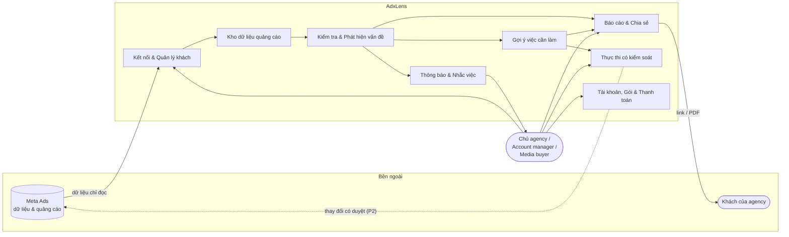
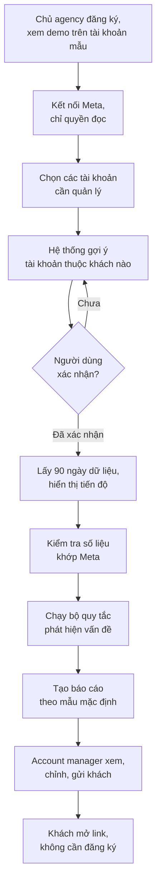
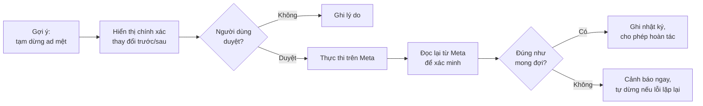

# AdxLens — Kiến trúc L1: Khái niệm (Conceptual)

| | |
|---|---|
| **Sản phẩm** | AdxLens — Báo cáo & Ads Intelligence cho Agency (Meta Ads) |
| **Phiên bản** | 0.2 |
| **Ngày** | 22/10/2026 |
| **Tài liệu nguồn** | PRD AdxLens v0.4 |
| **Tài liệu liên quan** | L2 — Kiến trúc Logic; L3 — Kiến trúc Kỹ thuật & Triển khai |
| **Người đọc** | Founder, marketing, design partner, nhà đầu tư, bất kỳ ai cần hiểu "hệ thống làm gì" mà không cần nền tảng kỹ thuật |

---

## 1. Bài toán kinh doanh

Agency quảng cáo nhỏ quản lý nhiều tài khoản Meta Ads cho nhiều khách hàng. Mỗi tháng họ phải chứng minh cho khách: **tiền quảng cáo đi đâu, đang hiệu quả hay không, và agency đã làm gì**. Việc này tốn nhiều giờ, chất lượng không đồng đều giữa các nhân sự, và một báo cáo sai số liệu có thể làm mất khách.

AdxLens giải quyết bài toán đó bằng cách **biến dữ liệu thô từ Meta thành báo cáo có bằng chứng, khớp số liệu, mang thương hiệu của agency, trong vài phút**. Sau đó hệ thống leo dần theo "thang tin cậy":

```
ĐỌC  →  GỢI Ý  →  HÀNH ĐỘNG CÓ DUYỆT  →  TỰ CHẠY CÓ PHANH
(P0)     (P1)          (P2a)                  (P2b)
```

Mỗi bậc đòi hỏi người dùng tin hệ thống nhiều hơn bậc trước, và hệ thống chỉ được phép leo lên khi đã chứng minh là đúng ở bậc dưới.

Toàn bộ bốn bậc được xây sẵn trong một lượt, nhưng mỗi bậc có một **"công tắc"** riêng cho từng agency. Người quản lý sản phẩm chỉ bật công tắc của bậc tiếp theo cho một agency khi bậc trước đã chạy ổn với họ. Tắt công tắc thì tính năng ẩn đi ngay, dữ liệu vẫn giữ nguyên.

---

## 2. Mục tiêu & phạm vi

### 2.1 Mục tiêu hệ thống
1. Tạo được báo cáo gửi khách trong **≤ 10 phút** sau khi kết nối tài khoản.
2. Số liệu trong báo cáo **lệch không quá 1%** so với Meta Ads Manager.
3. Trở thành một phần của **chu kỳ báo cáo định kỳ** của agency.
4. Cho phép thực thi thay đổi trên quảng cáo **chỉ khi có người duyệt**, rồi mới tự động hóa trong giới hạn.
5. Không bao giờ dùng dữ liệu của khách cho mục đích ngoài việc phục vụ chính agency đó.

### 2.2 Trong phạm vi

| Giai đoạn | Hệ thống làm gì |
|---|---|
| **P0** | Kết nối tài khoản Meta (chỉ đọc), tự động kiểm tra (audit) để tìm vấn đề, tạo báo cáo có thương hiệu, chia sẻ cho khách qua link hoặc PDF, nhắc việc hằng tuần |
| **P1** | Phân tích creative (ảnh/video quảng cáo) nào đang thắng hay mệt; danh sách việc cần làm hằng tuần; thu phí |
| **P2a** | Người dùng duyệt một gợi ý bằng một click, hệ thống thực thi thay đổi trên Meta thay họ, ghi nhật ký và cho hoàn tác |
| **P2b** | Người dùng đặt quy tắc, hệ thống tự chạy trong giới hạn đã đặt, có "phanh" (kill switch) |

### 2.3 Ngoài phạm vi
- Tự xây hệ thống đo lường chuyển đổi/attribution (chỉ tích hợp).
- Phục vụ doanh nghiệp lớn (SSO, phê duyệt đa tầng).
- Thay thế Meta Ads Manager.
- Tạo creative hàng loạt bằng AI (chỉ xem xét ở P3).
- Kênh quảng cáo khác ngoài Meta trước P3.
- Xếp hạng hay giám sát hiệu suất cá nhân của nhân viên agency.

---

## 3. Các bên liên quan

| Bên | Vai trò với hệ thống | Điều họ cần |
|---|---|---|
| **Chủ agency / Account manager** (người mua, người gửi báo cáo) | Kết nối tài khoản của khách, tạo và gửi báo cáo, xem tổng quan các khách | Báo cáo đúng, đẹp, có thương hiệu, nhanh |
| **Media buyer** (người dùng hằng ngày) | Xem vấn đề và việc cần làm, duyệt hành động | Không bỏ sót, tiết kiệm giờ, không bị giám sát |
| **Khách của agency** (brand, shop) | Mở link báo cáo; chủ sở hữu dữ liệu quảng cáo | Hiểu tiền đi đâu; dữ liệu của mình an toàn |
| **Meta** | Nguồn dữ liệu và nơi thực thi thay đổi | Ứng dụng tuân thủ chính sách và giới hạn truy cập |
| **Đội AdxLens** (PM, marketing; code do Claude Code viết) | Vận hành, hỗ trợ, hiệu chỉnh quy tắc, bật/tắt công tắc tính năng cho từng agency | Biết khi nào số liệu lệch hoặc thực thi lỗi, mà không cần ngồi canh hệ thống |

---

## 4. Sơ đồ khối tổng quan



### 4.1 Mô tả các khối

| Khối | Chức năng kinh doanh | Giai đoạn |
|---|---|---|
| **K1. Kết nối & Quản lý khách** | Kết nối tài khoản Meta của agency bằng đăng nhập chính thức, chỉ với quyền đọc. Sắp xếp tài khoản theo từng khách (Client); người dùng phải xác nhận mỗi tài khoản thuộc khách nào trước khi chia sẻ bất kỳ báo cáo nào | P0 |
| **K2. Kho dữ liệu quảng cáo** | Lưu bản sao dữ liệu hiệu quả quảng cáo theo ngày (90 ngày lịch sử, cập nhật hằng ngày). Giữ đúng định nghĩa chỉ số, múi giờ, tiền tệ của từng tài khoản để số liệu khớp Ads Manager | P0 |
| **K3. Kiểm tra & Phát hiện vấn đề** | Áp bộ quy tắc lên dữ liệu để tìm vấn đề: quảng cáo mệt, ngân sách dồn chỗ kém hiệu quả, quảng cáo tốt bị bỏ đói, tiêu tiền không chuyển đổi... Mỗi phát hiện kèm bằng chứng, mức độ, tác động ước tính và cách tính. Tự kiểm tra số liệu khớp Meta | P0 |
| **K4. Gợi ý việc cần làm** | Từ phát hiện, tạo danh sách việc nên làm, xếp theo tác động và độ tin cậy. Ở P1 thêm phân tích creative (ảnh/video nào thắng, mệt) | P1 |
| **K5. Báo cáo & Chia sẻ** | Tạo báo cáo mang thương hiệu agency bằng tiếng Việt/Anh, kèm tóm tắt dễ hiểu và ghi rõ "khớp Meta tính đến [thời điểm]". Chia sẻ qua link không cần đăng nhập hoặc PDF; gửi theo lịch | P0 |
| **K6. Thực thi có kiểm soát** | Thực hiện thay đổi trên Meta thay người dùng: P2a chỉ khi có người duyệt từng việc; P2b tự chạy trong giới hạn với nhật ký đầy đủ, hoàn tác và nút dừng khẩn cấp | P2 |
| **K7. Thông báo & Nhắc việc** | Email tổng hợp hằng tuần, nhắc lịch báo cáo khách, cảnh báo khi có vấn đề mới hoặc khi thực thi lỗi | P0 |
| **K8. Tài khoản, Gói & Thanh toán** | Workspace cho agency, thành viên và phân quyền theo khách, gói miễn phí/trả phí theo số tài khoản đang hoạt động, thanh toán | P0–P1 |

---

## 5. Quy trình nghiệp vụ cốt lõi

### 5.1 QT-01: Từ kết nối đến báo cáo đầu tiên (P0)



Mục tiêu: từ bước B đến bước I trong **≤ 10 phút**.

### 5.2 QT-02: Chu kỳ báo cáo định kỳ (P0)

1. Hằng ngày, hệ thống cập nhật dữ liệu và chạy lại kiểm tra.
2. Hằng tuần, email tổng hợp gửi cho account manager: sức khỏe từng khách, vấn đề mới, lịch báo cáo sắp tới.
3. Đến lịch, hệ thống tạo sẵn báo cáo; account manager xem và gửi (hoặc gửi tự động nếu đã bật).
4. Khách mở báo cáo; hệ thống ghi nhận để agency biết khách đã xem.

### 5.3 QT-03: Tuần làm việc của media buyer (P1)

1. Đầu tuần, media buyer nhận danh sách việc cần làm, xếp theo tác động.
2. Mỗi việc có bằng chứng và nút mở đúng chỗ trong Ads Manager để làm thủ công.
3. Media buyer đánh dấu đã làm hoặc bỏ qua (kèm lý do, kể cả "gợi ý sai").
4. Hệ thống theo dõi chỉ số trước/sau và dùng phản hồi để cải thiện gợi ý.

### 5.4 QT-04: Hành động có duyệt (P2a)



### 5.5 QT-05: Tự chạy có phanh (P2b)

1. Người dùng chọn một mẫu quy tắc (ví dụ: tạm dừng ad khi CPA vượt ngưỡng sau khi đủ dữ liệu) và đặt giới hạn: ngân sách tối đa được đổi, số hành động mỗi ngày, danh sách loại trừ, khung giờ.
2. Hệ thống chạy thử trên dữ liệu lịch sử và cho xem "tuần qua quy tắc này sẽ làm gì".
3. Quy tắc chạy ở chế độ "bóng" (chỉ ghi, không làm) trong vài ngày để người dùng xác nhận.
4. Khi bật thật, mọi hành động nằm trong giới hạn, được ghi nhật ký, thông báo và có thể hoàn tác; có nút dừng toàn bộ.

### 5.6 QT-06: Xử lý khi số liệu lệch (vận hành)

1. Hệ thống tự so sánh số liệu với Meta mỗi lần đồng bộ.
2. Nếu lệch quá 1%, báo cáo liên quan bị gắn cảnh báo nội bộ và đội AdxLens được thông báo trước khi khách nhìn thấy.
3. Hệ thống tự chạy lại đối chiếu sau 24 giờ (thường do Meta cập nhật số liệu trễ). Nếu vẫn lệch, đội AdxLens xử lý với ưu tiên cao nhất và giải thích nguyên nhân (ví dụ: cửa sổ attribution khác).

### 5.7 QT-07: Phát hành tính năng cho một agency

1. Tính năng mới đã xây sẵn nhưng đang tắt với mọi agency.
2. Người quản lý sản phẩm kiểm tra checklist của bậc đó: bậc trước đã ổn với agency này chưa, các kiểm tra tự động đã đạt chưa.
3. Bật công tắc cho agency đó và ghi lại lý do.
4. Theo dõi một thời gian; nếu có vấn đề, tắt công tắc ngay. Dữ liệu và cấu hình vẫn giữ nguyên.

### 5.8 QT-08: Hệ thống tự xử lý sự cố

1. Lỗi tạm thời (Meta quá tải, mạng chập chờn, tác vụ treo): hệ thống tự thử lại, tự giảm tốc, tự khởi động lại, không cần người.
2. Lỗi khi thực thi thay đổi trên quảng cáo: hệ thống tự dừng thực thi cho tài khoản đó và báo ngay cho đội AdxLens.
3. Lỗi trong phần mềm: hệ thống ghi lại, trợ lý AI phân tích nguyên nhân và đề xuất bản sửa; người quản lý sản phẩm duyệt trước khi áp dụng.

---

## 6. Nguyên tắc kiến trúc ở mức khái niệm

| # | Nguyên tắc | Hệ quả thiết kế |
|---|---|---|
| 1 | **Số liệu phải khớp Meta** | Có một khối riêng chuyên đối chiếu; không báo cáo nào ra ngoài khi đang có cảnh báo lệch |
| 2 | **Đọc trước, ghi sau** | Khối thực thi (K6) tách biệt hoàn toàn và chỉ được bật khi người dùng chọn |
| 3 | **Mọi phát hiện có bằng chứng** | Phát hiện và bằng chứng lưu cùng nhau; AI chỉ diễn giải, không tạo ra con số |
| 4 | **Dữ liệu của khách thuộc về khách** | Dữ liệu tách biệt theo từng khách; không trộn giữa các agency; không dùng cho benchmark khi chưa có đồng ý |
| 5 | **Không giám sát cá nhân** | Tổng quan chỉ ở mức khách và tài khoản |
| 6 | **Nhỏ, tự vận hành** | Không có người trực kỹ thuật toàn thời gian: dùng dịch vụ quản lý sẵn, ít thành phần; hệ thống tự phát hiện và tự xử lý lỗi thường gặp; con người chỉ được gọi khi cần quyết định |
| 7 | **Sẵn sàng toàn cầu, bắt đầu ở VN/SEA** | Đa ngôn ngữ, đa tiền tệ, múi giờ theo tài khoản ngay từ đầu |
| 8 | **Xây một lượt, bật từng bước** | Mọi bậc đều có công tắc theo từng agency; tắt được ngay mà không mất dữ liệu |

---

## 7. Chỉ số thành công của hệ thống

| Chỉ số | Ý nghĩa kinh doanh | Mục tiêu |
|---|---|---|
| Thời gian đến báo cáo đầu tiên | Giá trị thấy ngay | ≤ 10 phút |
| Tỷ lệ báo cáo khớp số liệu | Niềm tin của khách | ≥ 99% |
| Báo cáo gửi khách mỗi tài khoản mỗi tháng | AdxLens đã vào quy trình của agency | ≥ 1 |
| Tỷ lệ gợi ý được làm theo | Chất lượng gợi ý | ≥ 30% |
| Sự cố thực thi nghiêm trọng | An toàn khi hành động | 0 |

---

## 8. Giả định & phụ thuộc

- Meta cho phép đọc đủ dữ liệu cần thiết và duyệt ứng dụng trong thời gian chấp nhận được (kiểm chứng ở V0).
- Agency sẵn sàng kết nối tài khoản của khách vào AdxLens khi thấy demo và cam kết chỉ đọc.
- Quy định bảo vệ dữ liệu tại Việt Nam/SEA cho phép mô hình "AdxLens xử lý thay mặt agency" với điều khoản phù hợp (cần tư vấn pháp lý).
