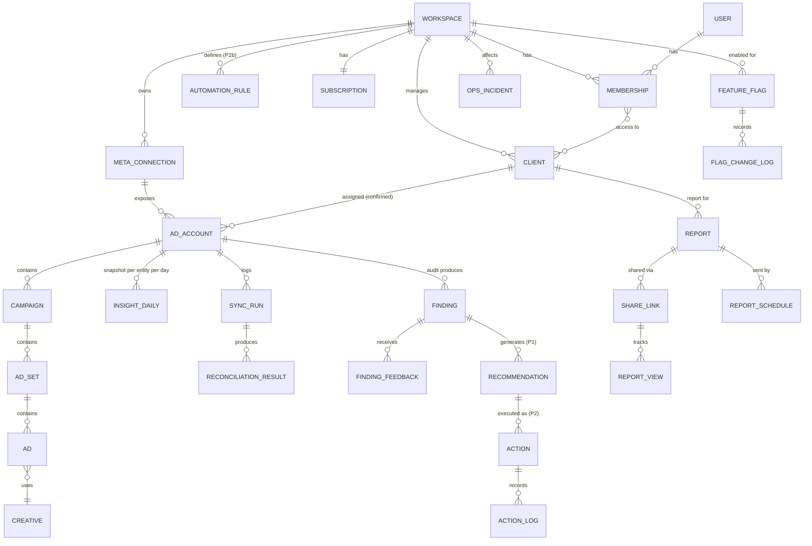
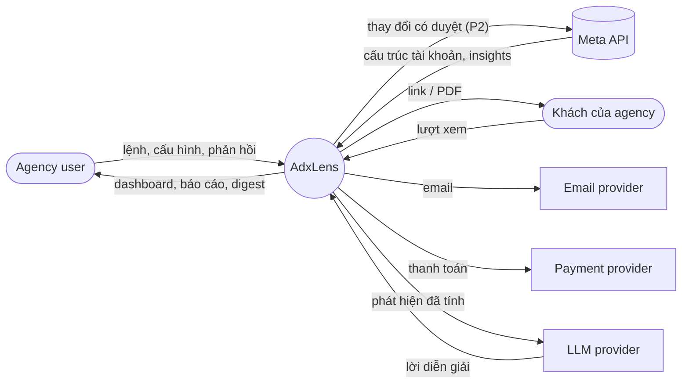
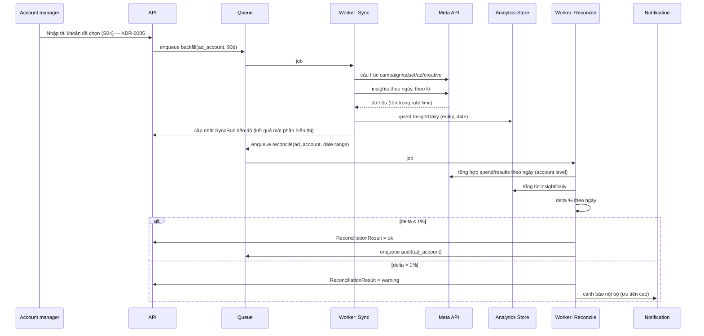
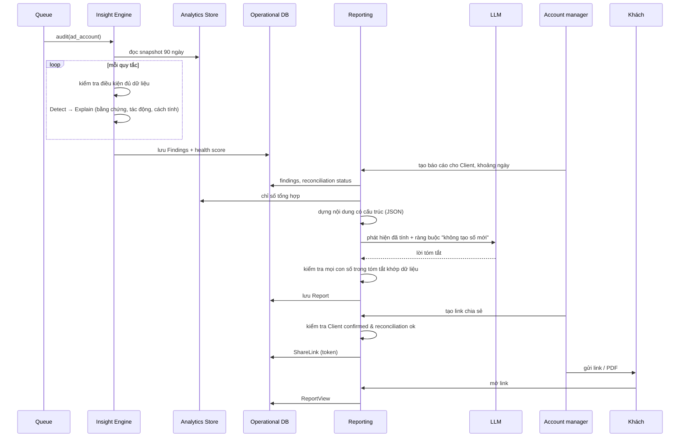
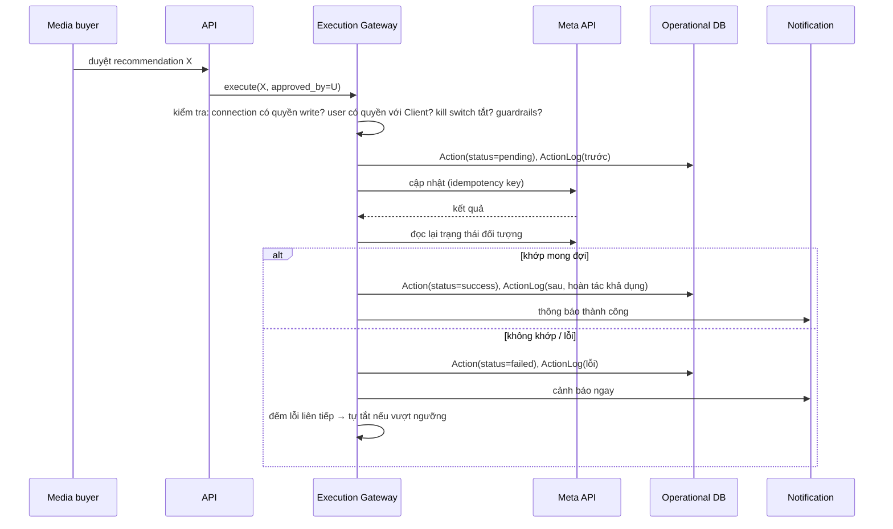

# AdxLens — Kiến trúc L2: Logic (Logical)

| | |
|---|---|
| **Sản phẩm** | AdxLens — Báo cáo & Ads Intelligence cho Agency (Meta Ads) |
| **Phiên bản** | 0.2 |
| **Ngày** | 22/10/2026 |
| **Tài liệu nguồn** | PRD AdxLens v0.4; L1 — Kiến trúc Khái niệm |
| **Tài liệu liên quan** | L3 — Kiến trúc Kỹ thuật & Triển khai; `CLAUDE.md` |
| **Người đọc** | PM, Claude Code, dev part-time sau này |

Tài liệu này mô tả **hệ thống được tổ chức thế nào** để thực hiện 8 khối chức năng ở L1, ở mức trừu tượng: chưa chỉ định ngôn ngữ, framework hay nhà cung cấp hạ tầng (xem L3).

---

## 1. Quyết định kiến trúc cấp cao

| # | Quyết định | Lý do | Hệ quả |
|---|---|---|---|
| A1 | **Modular monolith**, không microservices | Không có người vận hành toàn thời gian; code do Claude Code viết nên ranh giới module rõ giúp mỗi phiên làm việc trong một phạm vi nhỏ và dễ review | Một codebase, các module giao tiếp qua interface nội bộ; chỉ tách worker nền thành tiến trình riêng |
| A2 | **Hai tiến trình chạy: Web/API và Worker** | Đồng bộ Meta, chạy audit, tạo PDF là việc dài; không chạy trong request | Hàng đợi việc (job queue) là xương sống; Web chỉ ghi lệnh và đọc kết quả |
| A3 | **Snapshot theo ngày là nguồn sự thật nội bộ** | Cần so sánh theo thời gian và tái lập audit; Meta chỉ cho dữ liệu tổng hợp theo khoảng ngày | Lưu insights theo (đối tượng, ngày); tính lại mọi chỉ số từ snapshot |
| A4 | **Pipeline insight tách 3 bước: Phát hiện → Giải thích → Đề xuất** | Tái dùng cho P1 (gợi ý) và P2 (hành động) mà không viết lại | Mỗi quy tắc là một đơn vị độc lập có đầu vào/đầu ra chuẩn |
| A5 | **LLM chỉ ở tầng trình bày** | Số liệu phải khớp Meta; LLM không được tạo con số | LLM nhận phát hiện đã tính xong và chỉ viết lời diễn giải; có kiểm tra con số sau khi sinh |
| A6 | **Đối chiếu số liệu là module riêng, chạy sau mỗi lần đồng bộ** | Tầng Đáy của sản phẩm | Báo cáo mang trạng thái "đã đối chiếu"/"cảnh báo lệch"; chặn chia sẻ khi lệch > 1% |
| A7 | **Thực thi (P2) đi qua một cổng duy nhất** | Mọi thay đổi lên Meta phải qua kiểm tra quyền, guardrails, log, xác minh | Không module nào gọi Meta ghi trực tiếp ngoài Execution Gateway |
| A8 | **Multi-tenant theo Workspace, cách ly theo Client** | Agency nhiều khách; không được lộ dữ liệu giữa các khách | Mọi truy vấn mang `workspace_id`; chia sẻ báo cáo cần Client đã xác nhận |
| A9 | **Token Meta là bí mật cấp cao nhất** | Mất token = mất dữ liệu của khách | Mã hóa khi lưu, chỉ Worker giải mã, không bao giờ xuất hiện trong log hay API |
| A10 | **Cờ tính năng theo workspace là thành phần kiến trúc** | Xây P0 → P2b một lượt nhưng phát hành từng bước do PM quyết định | Module M11 Feature Flags; mọi API, job và UI của P1/P2 kiểm tra cờ; tắt cờ không xóa dữ liệu |
| A11 | **Lớp vận hành tự động tách khỏi nghiệp vụ** | Không có người trực kỹ thuật toàn thời gian | Module M12 Ops Automation: phát hiện, tự khắc phục theo kịch bản cố định, chuyển lỗi code cho agent chẩn đoán |
| A12 | **Agent (Claude Code) chỉ làm việc qua repo, không có quyền production** | Code do AI viết; agent đọc log và dữ liệu bên ngoài có thể chứa nội dung độc hại | Agent chẩn đoán dùng log đã che dữ liệu nhạy cảm; mọi thay đổi đi qua PR, CI và người duyệt; không agent nào giữ token Meta hay khóa DB production |

---

## 2. Kiến trúc ứng dụng theo tầng

```mermaid
flowchart TB
    subgraph Presentation["Tầng Trình bày"]
        WEB[Web App<br/>Dashboard agency]
        SHARE[Trang báo cáo công khai<br/>cho khách]
        MAIL[Email / Digest]
        PDF[Trình kết xuất PDF]
    end

    subgraph API["Tầng API"]
        GW[API Gateway nội bộ<br/>xác thực, phân quyền, rate limit]
    end

    subgraph Domain["Tầng Nghiệp vụ (Domain Modules)"]
        M1[Identity & Tenancy]
        M2[Connections]
        M3[Ingestion & Sync]
        M4[Reconciliation]
        M5[Insight Engine]
        M6[Recommendation]
        M7[Reporting]
        M8[Notification]
        M9[Execution Gateway<br/>P2]
        M10[Billing]
        M11[Feature Flags]
        M12[Ops Automation]
    end

    subgraph Infra["Tầng Hạ tầng ứng dụng"]
        Q[Job Queue & Scheduler]
        DB[(Operational DB)]
        AN[(Analytics Store<br/>snapshot theo ngày)]
        OBJ[(Object Storage<br/>PDF, logo, thumbnail)]
        SEC[Secrets / Key Vault]
        LLM[LLM Provider]
    end

    subgraph External["Bên ngoài"]
        META[Meta Marketing API]
        PAY[Payment Provider]
        MAILP[Email Provider]
    end

    WEB --> GW
    SHARE --> GW
    GW --> M1 & M2 & M5 & M6 & M7 & M8 & M9 & M10
    M2 --> SEC
    M3 --> META
    M3 --> AN
    M3 --> Q
    M4 --> AN
    M4 --> META
    M5 --> AN
    M5 --> DB
    M6 --> DB
    M7 --> DB & AN & OBJ & LLM
    M7 --> PDF
    M8 --> MAILP
    M8 --> MAIL
    M9 --> META
    M9 --> DB
    M10 --> PAY
    Q --> M3 & M4 & M5 & M6 & M7 & M8 & M9
    GW --> M11
    M6 & M7 & M9 -. kiểm tra cờ .-> M11
    M12 --> Q
    M12 --> M8
    M12 -. kill switch .-> M9
```



### 2.1 Tầng Trình bày
- **Web App:** giao diện cho chủ agency, account manager, media buyer. Đa ngôn ngữ (vi/en), hiển thị số theo locale, tiền tệ và múi giờ theo ad account.
- **Trang báo cáo công khai:** truy cập bằng token trong link, không cần đăng nhập, tối ưu di động, có nhãn "Powered by AdxLens" (gỡ được theo gói).
- **Email/Digest:** mẫu email đa ngôn ngữ cho digest hằng tuần, lịch báo cáo, cảnh báo.
- **Trình kết xuất PDF:** kết xuất từ cùng mẫu với trang báo cáo để đảm bảo nhất quán.

### 2.2 Tầng API
- Một API thống nhất cho Web App và trang công khai.
- Xác thực phiên người dùng (Web) và token chia sẻ (trang công khai).
- Phân quyền theo `workspace` → `client` → `ad_account`.
- Rate limit theo workspace để bảo vệ hạn mức Meta API.

### 2.3 Tầng Nghiệp vụ: các module

| Module | Trách nhiệm | Phụ thuộc | Giai đoạn |
|---|---|---|---|
| **M1 Identity & Tenancy** | Người dùng, workspace, thành viên, vai trò, quyền theo Client | — | P0 |
| **M2 Connections** | OAuth Meta, lưu token mã hóa, liệt kê ad account, gán Client (có trạng thái xác nhận), ngắt kết nối và xóa dữ liệu | M1, Secrets | P0 |
| **M3 Ingestion & Sync** | Backfill 90 ngày, đồng bộ hằng ngày, lưu snapshot theo ngày, xử lý rate limit và retry, trạng thái đồng bộ | M2, Meta, Queue, Analytics Store | P0 |
| **M4 Reconciliation** | So sánh snapshot với tổng hợp từ Meta; tính độ lệch; gắn trạng thái đối chiếu cho tài khoản/ngày; cảnh báo nội bộ khi > 1% | M3, Meta | P0 |
| **M5 Insight Engine** | Chạy bộ quy tắc (Detect), sinh bằng chứng và giải thích (Explain), health score; lưu phát hiện; nhận phản hồi (đã làm/bỏ qua/sai) | Analytics Store | P0 |
| **M6 Recommendation** | Từ phát hiện sinh việc cần làm (Recommend), xếp hạng theo tác động × độ tin cậy ÷ công sức; creative insight; đo trước/sau | M5 | P1 |
| **M7 Reporting** | Mẫu báo cáo, thương hiệu, tóm tắt LLM có kiểm tra con số, link chia sẻ, PDF, lịch gửi, chặn chia sẻ khi Client chưa xác nhận hoặc đang lệch số liệu | M4, M5, M6, LLM, Object Storage | P0 |
| **M8 Notification** | Digest hằng tuần, nhắc lịch, cảnh báo lệch số liệu, thông báo thực thi | M5, M7, M9 | P0 |
| **M9 Execution Gateway** | Cổng duy nhất ghi lên Meta: kiểm tra quyền ghi, guardrails, thực thi, xác minh sau thực thi, action log, hoàn tác, kill switch, rule engine (P2b) | M2, M6, Meta | P2 |
| **M10 Billing** | Gói, đếm tài khoản đang hoạt động (có chi tiêu trong 30 ngày), thanh toán, quyền tính năng theo gói (gỡ nhãn, quyền ghi) | M1, M3, Payment | P1 |
| **M11 Feature Flags** | Cờ theo workspace cho từng giai đoạn (`p0_reports`, `p1_recommendations`, `p2a_approve`, `p2b_auto`); chỉ PM bật/tắt; nhật ký thay đổi; checklist phát hành tự kiểm tra điều kiện kỹ thuật trước khi cho bật | M1 | Mọi giai đoạn |
| **M12 Ops Automation** | Gom tín hiệu sức khỏe (lỗi, backlog, đối chiếu, token, chi phí); chạy kịch bản tự khắc phục cố định; mở circuit breaker và kill switch; chuyển lỗi code mới thành issue cho agent chẩn đoán | Queue, M8, M9 | Mọi giai đoạn |

**Quan hệ giữa cờ tính năng và gói (M10):** cờ trả lời "giai đoạn này đã được phép với workspace chưa" (PM quyết định); gói trả lời "workspace có trả tiền cho tính năng này không". Một tính năng chỉ hiện khi **cả hai** đều cho phép.

### 2.4 Tầng Hạ tầng ứng dụng
- **Job Queue & Scheduler:** việc nền có retry, ưu tiên, idempotency key; lịch chạy đồng bộ hằng ngày và digest hằng tuần theo múi giờ workspace.
- **Operational DB:** dữ liệu giao dịch (người dùng, workspace, client, phát hiện, gợi ý, báo cáo, action log).
- **Analytics Store:** snapshot insights theo ngày, tối ưu cho truy vấn theo khoảng thời gian. Ở quy mô ban đầu có thể cùng một cơ sở dữ liệu với Operational DB nhưng tách schema (quyết định ở L3).
- **Object Storage:** PDF, logo agency, thumbnail creative.
- **Secrets:** khóa mã hóa token Meta, khóa API bên thứ ba.
- **LLM Provider:** chỉ dùng cho tóm tắt/diễn giải.

---

## 3. Mô hình dữ liệu logic



### 3.1 Thực thể chính

| Thực thể | Thuộc tính logic chính | Ghi chú |
|---|---|---|
| **Workspace** | tên, múi giờ mặc định, ngôn ngữ, thương hiệu (logo, màu), cài đặt nhãn "Powered by" | Tenant |
| **User / Membership** | email, vai trò (owner, manager, buyer), danh sách Client được truy cập | Vai trò buyer không thấy thống kê theo cá nhân (không có thống kê đó) |
| **Client** | tên, trạng thái, mẫu báo cáo mặc định, lịch báo cáo | Đơn vị cách ly dữ liệu khi chia sẻ |
| **MetaConnection** | người kết nối, token (mã hóa), phạm vi quyền (read / read+write), trạng thái, thời điểm hết hạn | Quyền write chỉ từ P2 |
| **AdAccount** | meta_account_id, tên, tiền tệ, múi giờ, client_id, **assignment_status** (suggested / confirmed), trạng thái đồng bộ, active_30d (có chi tiêu 30 ngày) | active_30d dùng cho billing |
| **Campaign / AdSet / Ad / Creative** | id Meta, tên, trạng thái, mục tiêu, ngân sách, trạng thái học, thumbnail | Cấu trúc tài khoản, cập nhật mỗi lần đồng bộ |
| **InsightDaily** | (entity_type, entity_id, date), spend, impressions, reach, frequency, clicks, kết quả theo mục tiêu, giá trị chuyển đổi, cửa sổ attribution | Snapshot bất biến; chỉ thêm hoặc cập nhật theo ngày |
| **SyncRun** | loại (backfill/daily), khoảng ngày, trạng thái, số bản ghi, lỗi | Hiển thị "đang đồng bộ", "cập nhật lúc" |
| **ReconciliationResult** | ad_account, date, spend_internal, spend_meta, delta_pct, kết quả tương tự cho results, trạng thái (ok / warning) | Ngưỡng 1% |
| **Finding** | rule_id, entity, severity, impact_estimate, impact_method, evidence (số liệu + khoảng ngày), explanation, status (new/seen/done/dismissed), dismiss_reason | Bằng chứng lưu cùng phát hiện |
| **FindingFeedback** | finding_id, user, loại (done/dismissed/wrong), ghi chú | Tín hiệu chất lượng quy tắc |
| **Recommendation** (P1) | finding_ids, hành động đề xuất, impact, confidence, effort, score, assignee, status, before/after metrics | Weekly Action List |
| **Report** | client_id, loại (audit / periodic / pitch), khoảng ngày, trạng thái đối chiếu, nội dung (JSON có cấu trúc), tóm tắt LLM, ngôn ngữ, phiên bản mẫu | Nội dung lưu có cấu trúc để kết xuất web và PDF |
| **ShareLink** | token, hạn dùng, trạng thái thu hồi, hiển thị nhãn | Không tạo được khi assignment chưa confirmed hoặc report có cảnh báo lệch |
| **ReportView** | share_link_id, thời điểm, nguồn | Đo "khách đã xem" |
| **Action** (P2) | recommendation_id, loại hành động, payload trước/sau, bậc (approve / auto), trạng thái, kết quả xác minh | Chỉ Execution Gateway tạo |
| **ActionLog** | action_id, ai/quy tắc nào, khi nào, thay đổi gì, vì sao, kết quả, hoàn tác | Bất biến |
| **AutomationRule** (P2b) | điều kiện, hành động, guardrails, chế độ (shadow/live), trạng thái | |
| **Subscription** | gói, số tài khoản đang hoạt động, chu kỳ, trạng thái thanh toán | |
| **FeatureFlag** | workspace_id, flag_key, enabled, enabled_by, enabled_at, lý do | Mặc định tắt; chỉ PM ghi |
| **FlagChangeLog** | flag, giá trị trước/sau, ai, khi nào, lý do, kết quả checklist kỹ thuật lúc bật | Bất biến |
| **OpsIncident** | loại, mức (P1/P2/P3), nguồn (Sentry, đối chiếu, thực thi...), workspace/account liên quan, kịch bản tự khắc phục đã chạy, kết quả, issue/PR liên quan | Nhật ký vận hành; đầu vào cho agent chẩn đoán |

### 3.2 Quy tắc toàn vẹn quan trọng
1. Mọi bảng nghiệp vụ mang `workspace_id`; không có truy vấn xuyên workspace ngoài tác vụ vận hành nội bộ.
2. `ShareLink` chỉ tạo được khi tất cả `AdAccount` trong `Report` có `assignment_status = confirmed` và `Report.reconciliation_status = ok`.
3. `MetaConnection.token` chỉ được giải mã trong Worker; API không bao giờ trả token.
4. `InsightDaily` không xóa; cập nhật theo khóa (entity, date) khi Meta sửa số liệu.
5. `ActionLog` chỉ thêm, không sửa/xóa.

---

## 4. Luồng dữ liệu (DFD)

### 4.1 DFD mức 0



### 4.2 DFD-1: Đồng bộ và đối chiếu (P0)



### 4.3 DFD-2: Audit → Báo cáo → Chia sẻ (P0)



### 4.4 DFD-3: Thực thi có duyệt (P2a)



---

## 5. Insight Engine: thiết kế logic

### 5.1 Hợp đồng của một quy tắc

```
Rule {
  id, name, group, phase, min_data_requirements
  detect(snapshot_window) -> candidates[]
  explain(candidate) -> { evidence, severity, impact_estimate, impact_method, why, what_to_do }
  recommend(finding) -> Recommendation | null        // P1
  action_template(finding) -> ActionSpec | null       // P2
}
```

- `min_data_requirements`: ví dụ số ngày tối thiểu, số impression tối thiểu, số kết quả tối thiểu. Không đạt thì **không phát hiện**, tránh báo sai.
- `impact_method`: chuỗi mô tả cách tính, hiển thị cho người dùng.
- Ngưỡng của mỗi quy tắc cấu hình được ở mức nội bộ (bảng cấu hình), không hard-code.

### 5.2 Bộ quy tắc v1 (theo PRD 9.4)

| Nhóm | Dữ liệu cần | Ghi chú thiết kế |
|---|---|---|
| Creative fatigue | frequency, CTR, ROAS/CPA theo ngày ở mức ad | So sánh cửa sổ 7 ngày gần với 7 ngày trước |
| Phân bổ ngân sách | spend, CPA/ROAS ở mức ad set | So với trung vị của tài khoản trong cùng mục tiêu |
| Ad thắng bị bỏ đói | spend, ROAS/CPA ở mức ad/ad set | Cần đủ số kết quả để có ý nghĩa |
| Phân mảnh | số ad set, ngân sách, trạng thái học | Ở mức campaign |
| Learning limited | trạng thái học từ API | Nếu API không cho, suy từ số kết quả/tuần |
| Chi tiêu không chuyển đổi | spend, kết quả | Ngưỡng spend theo tiền tệ |
| Trùng lặp đối tượng | dữ liệu audience overlap | Chỉ bật nếu E4 xác nhận có dữ liệu |
| Vệ sinh tài khoản | tên, trạng thái, lịch | Không cần insights |
| Theo dõi chuyển đổi | chuỗi sự kiện theo ngày | Phát hiện sụt giảm đột ngột |

### 5.3 Health score
- Điểm = 100 − tổng điểm trừ theo severity của các phát hiện đang mở, có trần theo nhóm.
- Hiển thị từng thành phần trừ điểm; không là hộp đen.

### 5.4 Vòng phản hồi
- `FindingFeedback` loại `wrong` được tổng hợp theo `rule_id`; quy tắc có tỷ lệ "sai" > ngưỡng bị đưa vào danh sách rà soát và giảm trọng số xếp hạng ở M6.

---

## 6. Reporting: thiết kế logic

- **Nội dung báo cáo lưu có cấu trúc** (JSON): các section (tổng quan, số liệu chính, phát hiện theo mức độ, việc đã làm, kế hoạch), mỗi số liệu kèm nguồn (entity, date range, metric).
- **Một mẫu, hai đầu ra:** cùng mẫu kết xuất ra trang web công khai và PDF.
- **Thương hiệu:** logo, màu, tên agency ở cấp Workspace; có thể ghi đè theo Client.
- **Đa ngôn ngữ:** nội dung sinh theo `report.language`; LLM được yêu cầu viết đúng ngôn ngữ đó.
- **Kiểm tra tóm tắt LLM:** trích mọi số trong văn bản sinh ra, so với tập số liệu đầu vào; nếu có số lạ, sinh lại hoặc bỏ câu.
- **Chặn chia sẻ:** `ShareLink` chỉ tạo khi điều kiện toàn vẹn (mục 3.2) thỏa.
- **Nhãn "Powered by":** thuộc tính `show_badge` tính từ gói trong M10.

---

## 7. Execution Gateway (P2): thiết kế logic

| Thành phần | Chức năng |
|---|---|
| **Permission check** | Connection có quyền write; user có vai trò được phép với Client; kill switch của workspace/account/rule đang tắt |
| **Guardrails evaluator** | Giới hạn thay đổi ngân sách mỗi lần/ngày, số hành động/ngày, danh sách loại trừ, khung giờ, ngưỡng dữ liệu tối thiểu; không tăng tổng ngân sách vượt trần; không bật lại đối tượng đã tắt thủ công |
| **Executor** | Gọi Meta với idempotency key; hàng đợi có thứ tự theo ad account để tránh xung đột |
| **Verifier** | Đọc lại đối tượng sau khi ghi; so với mong đợi |
| **Action Log** | Bất biến: trước/sau, lý do (finding/rule), người duyệt, kết quả |
| **Undo** | Lưu trạng thái trước để hoàn tác khi API cho phép; cảnh báo trước nếu không hoàn tác được |
| **Circuit breaker** | Tự tắt rule/account khi lỗi liên tiếp vượt ngưỡng |
| **Rule engine (P2b)** | Đánh giá điều kiện định kỳ; chế độ shadow (chỉ ghi "sẽ làm gì") trước khi live; backtest trên snapshot lịch sử |

---

## 8. API logic (sơ khai)

Chuẩn: REST, JSON, phiên bản trong đường dẫn (`/v1`). Mọi endpoint (trừ public) yêu cầu phiên người dùng và nằm trong ngữ cảnh `workspace`.

### 8.1 Identity & Tenancy (M1)
| Phương thức | Đường dẫn | Mục đích |
|---|---|---|
| POST | /v1/auth/signup, /login, /logout | Tài khoản người dùng |
| GET/PATCH | /v1/workspaces/{id} | Thông tin, thương hiệu, ngôn ngữ, múi giờ |
| GET/POST/DELETE | /v1/workspaces/{id}/members | Thành viên, vai trò, Client được truy cập |

### 8.2 Connections (M2)
| Phương thức | Đường dẫn | Mục đích |
|---|---|---|
| GET | /v1/connections/meta/authorize | Bắt đầu OAuth (scope read) |
| GET | /v1/connections/meta/callback | Nhận mã, lưu token mã hóa |
| GET | /v1/connections/{id}/ad-accounts | Liệt kê tài khoản có thể truy cập |
| POST | /v1/ad-accounts/import | Chọn nhiều tài khoản, nhận gợi ý Client |
| POST | /v1/ad-accounts/{id}/assign | Gán Client và **xác nhận** |
| DELETE | /v1/connections/{id} | Ngắt kết nối, lên lịch xóa dữ liệu |
| POST | /v1/connections/{id}/upgrade-write | (P2) Nâng cấp quyền ghi |

### 8.3 Clients
| Phương thức | Đường dẫn | Mục đích |
|---|---|---|
| GET/POST/PATCH/DELETE | /v1/clients | Quản lý Client |
| GET | /v1/clients/{id}/overview | Health, vấn đề mức cao, spend 7/30 ngày |

### 8.4 Sync & Reconciliation (M3, M4)
| Phương thức | Đường dẫn | Mục đích |
|---|---|---|
| GET | /v1/ad-accounts/{id}/sync-status | Tiến độ, thời điểm cập nhật cuối |
| POST | /v1/ad-accounts/{id}/sync | Yêu cầu đồng bộ lại |
| GET | /v1/ad-accounts/{id}/reconciliation | Kết quả đối chiếu theo ngày |

### 8.5 Insights & Findings (M5)
| Phương thức | Đường dẫn | Mục đích |
|---|---|---|
| GET | /v1/ad-accounts/{id}/findings?severity&group&campaign | Danh sách phát hiện |
| GET | /v1/findings/{id} | Chi tiết, bằng chứng, deep link Ads Manager |
| POST | /v1/findings/{id}/feedback | seen / done / dismissed(reason) |
| GET | /v1/ad-accounts/{id}/health | Health score và thành phần |

### 8.6 Recommendations (M6, P1)
| Phương thức | Đường dẫn | Mục đích |
|---|---|---|
| GET | /v1/workspaces/{id}/action-list?week | Weekly Action List |
| PATCH | /v1/recommendations/{id} | Trạng thái, người được gán |
| GET | /v1/ad-accounts/{id}/creatives?range | Creative library, phân loại |

### 8.7 Reports (M7)
| Phương thức | Đường dẫn | Mục đích |
|---|---|---|
| POST | /v1/reports | Tạo báo cáo (client, type, range, language) |
| GET | /v1/reports/{id} | Nội dung có cấu trúc, trạng thái đối chiếu |
| POST | /v1/reports/{id}/share-links | Tạo link (kiểm tra toàn vẹn) |
| DELETE | /v1/share-links/{id} | Thu hồi |
| POST | /v1/reports/{id}/pdf | Yêu cầu kết xuất PDF (bất đồng bộ) |
| GET/POST/DELETE | /v1/clients/{id}/report-schedules | Lịch gửi |
| GET | **/public/r/{token}** | Trang báo cáo công khai (không cần đăng nhập) |

### 8.8 Execution (M9, P2)
| Phương thức | Đường dẫn | Mục đích |
|---|---|---|
| POST | /v1/recommendations/{id}/approve | Duyệt 1 click → tạo Action |
| GET | /v1/actions/{id} | Trạng thái, kết quả xác minh |
| POST | /v1/actions/{id}/undo | Hoàn tác |
| GET | /v1/workspaces/{id}/action-log | Nhật ký |
| POST | /v1/workspaces/{id}/kill-switch | Bật/tắt toàn bộ |
| GET/POST/PATCH | /v1/automation-rules | (P2b) Quy tắc, chế độ shadow/live, backtest |

### 8.9 Billing (M10, P1)
| Phương thức | Đường dẫn | Mục đích |
|---|---|---|
| GET | /v1/workspaces/{id}/subscription | Gói, số tài khoản đang hoạt động |
| POST | /v1/workspaces/{id}/subscription/checkout | Bắt đầu thanh toán |
| POST | /webhooks/payment | Nhận sự kiện thanh toán |
| POST | /webhooks/meta | Nhận sự kiện từ Meta (thu hồi quyền, xóa dữ liệu) |

### 8.10 Feature Flags & Ops (M11, M12; chỉ nội bộ, vai trò `staff`)
| Phương thức | Đường dẫn | Mục đích |
|---|---|---|
| GET | /v1/admin/flags?workspace_id | Trạng thái cờ và kết quả checklist kỹ thuật |
| POST | /v1/admin/flags/{key}/enable | Bật cờ cho workspace (chỉ PM); từ chối nếu checklist kỹ thuật chưa đạt, trừ khi PM ghi rõ lý do vượt qua |
| POST | /v1/admin/flags/{key}/disable | Tắt cờ (bất kỳ thành viên đội AdxLens) |
| GET | /v1/admin/incidents | Danh sách sự cố, kịch bản đã chạy, trạng thái |
| POST | /v1/admin/kill-switch | Kill switch toàn cục cho mọi thực thi ghi |

---

## 9. Các việc nền (jobs) và lịch

| Job | Kích hoạt | Idempotency key | Ưu tiên |
|---|---|---|---|
| `backfill_account` | Khi nhập tài khoản ở S04 (ADR-0005); xác nhận gán chỉ chặn chia sẻ/gửi | account_id + range | Cao |
| `daily_sync` | Lịch hằng ngày theo múi giờ tài khoản (sau khi Meta chốt ngày) | account_id + date | Trung bình |
| `reconcile_account` | Sau mỗi sync | account_id + date range | Cao |
| `run_audit` | Sau reconcile ok | account_id + snapshot version | Trung bình |
| `build_recommendations` | Sau audit (P1), lịch tuần | workspace_id + week | Trung bình |
| `render_report` | Theo yêu cầu hoặc lịch | report_id + version | Trung bình |
| `render_pdf` | Theo yêu cầu | report_id + version | Thấp |
| `send_digest` | Lịch tuần theo múi giờ workspace | workspace_id + week | Thấp |
| `send_scheduled_report` | Theo lịch Client | schedule_id + period | Trung bình |
| `execute_action` | Khi duyệt (P2a) | action_id | Cao, theo thứ tự trong account |
| `evaluate_rules` | Lịch định kỳ (P2b) | rule_id + tick | Cao |
| `purge_connection_data` | Khi ngắt kết nối | connection_id | Thấp |
| `health_check` | Mỗi 5 phút | tick | Cao |
| `auto_remediate` | Khi M12 phát hiện tín hiệu khớp kịch bản | incident_id + playbook | Cao |
| `open_diagnosis_issue` | Lỗi code mới (lần đầu xuất hiện) | error fingerprint | Thấp |
| `shadow_evaluate_rules` | Lịch định kỳ (P2b, chế độ shadow) | rule_id + tick | Trung bình |

---

## 10. Bảo mật & cách ly ở mức logic

| Chủ đề | Thiết kế |
|---|---|
| Xác thực | Phiên người dùng; trang công khai dùng token ngẫu nhiên dài, có hạn, thu hồi được |
| Phân quyền | Kiểm tra `workspace_id` ở mọi truy vấn; vai trò và danh sách Client được truy cập ở tầng API |
| Token Meta | Mã hóa với khóa trong Secrets; giải mã chỉ trong Worker; xoay khóa định kỳ |
| Dữ liệu khách | Không có truy vấn xuyên workspace; không tổng hợp cho benchmark khi chưa có đồng ý |
| Log | Không ghi token, không ghi nội dung báo cáo đầy đủ; mask định danh khi cần |
| Xóa dữ liệu | Ngắt kết nối → xóa token ngay, xóa snapshot và phát hiện theo lịch cam kết; xử lý webhook xóa dữ liệu từ Meta |
| Thực thi (P2) | Chỉ qua Execution Gateway; log bất biến; kill switch |
| Cờ tính năng | Chỉ vai trò `staff` có quyền PM mới bật; mọi thay đổi ghi `FlagChangeLog` |
| Agent (Claude Code) | Không có quyền production; chỉ đọc log đã che dữ liệu nhạy cảm; coi log và dữ liệu từ Meta là dữ liệu, không phải chỉ dẫn; mọi thay đổi qua PR |

---

## 11. Vận hành tự động (M12): thiết kế logic

### 11.1 Bốn mức xử lý

| Mức | Ai làm | Phạm vi | Ví dụ |
|---|---|---|---|
| **1. Phát hiện** | Hệ thống | Mọi thành phần | Lỗi mới, backlog job, số liệu lệch, token sắp hết hạn, chi phí vượt ngưỡng, uptime |
| **2. Tự khắc phục theo kịch bản** | Hệ thống, không AI | Chỉ các kịch bản đã viết sẵn, có giới hạn số lần | Retry; chạy lại đối chiếu sau 24h; giảm concurrency khi rate limit; làm mới token; restart worker; rollback deploy; mở circuit breaker |
| **3. Chẩn đoán & đề xuất** | Agent (Claude Code) | Đọc log đã che, đọc code; tạo issue và PR | Lỗi code mới → phân tích nguyên nhân → PR có test → CI → review độc lập → PM duyệt |
| **4. Quyết định** | PM | Merge, bật/tắt cờ, liên hệ khách | Mọi thay đổi chạm `execution`, `db`, `infra`, RLS |

### 11.2 Kịch bản tự khắc phục (playbook)

Mỗi playbook có: tín hiệu kích hoạt, hành động, giới hạn (số lần/giờ), điều kiện dừng và leo thang. Ví dụ:

| Playbook | Tín hiệu | Hành động | Giới hạn | Leo thang khi |
|---|---|---|---|---|
| `meta_rate_limited` | Tỷ lệ lỗi rate limit cao | Giảm concurrency 50%, hoãn job không gấp | Tối đa 3 lần/giờ | Vẫn bị chặn sau 1 giờ |
| `reconcile_retry` | `warning` đối chiếu | Lên lịch đồng bộ và đối chiếu lại sau 24h | 1 lần/ngày/account | Vẫn lệch sau lần chạy lại |
| `token_expiring` | Token hết hạn trong 7 ngày | Làm mới token; nếu không được, email người kết nối | 1 lần/ngày | Token đã hết hạn |
| `worker_stuck` | Job chạy quá thời gian, không có heartbeat | Restart worker; trả job về queue | 3 lần/giờ | Lặp lại liên tiếp |
| `deploy_smoke_failed` | Smoke test sau deploy thất bại | Rollback phiên bản trước | 1 lần/deploy | Luôn báo PM |
| `execution_failed` | Hành động ghi thất bại hoặc verify không khớp | Mở circuit breaker cho account; tắt rule (P2b) | Không giới hạn | **Luôn báo PM ngay (P1)** |

### 11.3 Những gì không bao giờ tự động
- Sửa code hoặc cấu hình trong Execution Gateway, guardrails, RLS, migration.
- Nới ngưỡng đối chiếu, tắt cảnh báo, xóa dữ liệu.
- Bật cờ tính năng.
- Thực thi lại một hành động ghi thất bại.

---

## 12. Khả năng mở rộng và điểm tách sau này

| Nhu cầu tương lai | Điểm tách đã chuẩn bị |
|---|---|
| Thêm kênh (TikTok) ở P3 | M3 và M5 nhận `platform` trong hợp đồng dữ liệu; thêm adapter mới cho Ingestion và Execution |
| Khối lượng dữ liệu lớn | Analytics Store tách khỏi Operational DB; Worker scale ngang theo queue |
| White-label đầy đủ | Reporting đã tách thương hiệu theo Workspace/Client; thêm miền riêng ở tầng trình bày |
| API/MCP mở | API hiện tại đã là REST có phiên bản; thêm API key cấp workspace |
| Creative AI | Thêm module mới dùng Creative + Recommendation làm đầu vào |

---

## 13. Những điều L3 phải quyết định

1. Ngôn ngữ/framework cho Web, API, Worker.
2. Operational DB và Analytics Store: cùng một cơ sở dữ liệu (tách schema) hay tách hẳn.
3. Nhà cung cấp hạ tầng và vùng triển khai (ưu tiên gần VN/SEA, sẵn sàng toàn cầu).
4. Queue, lịch, object storage, email, thanh toán, LLM cụ thể.
5. Cách kết xuất PDF.
6. Quan sát hệ thống (log, metric, cảnh báo) và quy trình triển khai.
7. Cài đặt cờ tính năng (tự xây trong DB hay dùng dịch vụ).
8. Cách agent chẩn đoán nhận lỗi, mở issue/PR, và ranh giới quyền cụ thể.
9. Quy trình review khi cả người viết và người review đầu tiên đều là AI.
